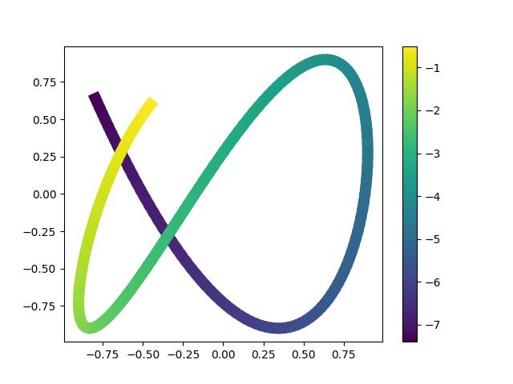
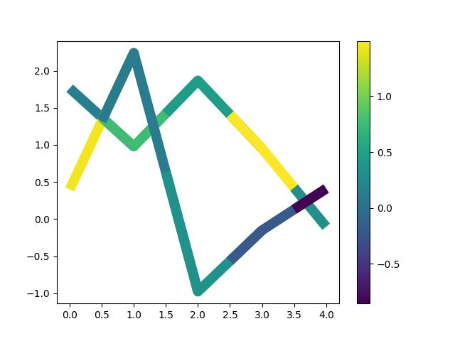

# Matplotlib Multicolored Line

<p align="center">
  <a href="https://github.com/34j/matplotlib-multicolored-line/actions/workflows/ci.yml?query=branch%3Amain">
    
  </a>
  <a href="https://matplotlib-multicolored-line.readthedocs.io">
    
  </a>
</p>
<p align="center">
  <a href="https://codecov.io/gh/34j/matplotlib-multicolored-line">
    
  </a>
  <a href="https://github.com/astral-sh/uv">
    
  </a>
  <a href="https://github.com/astral-sh/ruff">
    
  </a>
  <a href="https://github.com/j178/prek">
    
  </a>
</p>
<p align="center">
  <a href="https://pypi.org/project/matplotlib-multicolored-line/">
    
  </a>
  
  
</p>

---

**Documentation**: <a href="https://matplotlib-multicolored-line.readthedocs.io" target="_blank">https://matplotlib-multicolored-line.readthedocs.io </a>

**Source Code**: <a href="https://github.com/34j/matplotlib-multicolored-line" target="_blank">https://github.com/34j/matplotlib-multicolored-line </a>

---

Plot multicolored lines in Matplotlib. Port of [Multicolored lines — Matplotlib 3.10.1 documentation](https://matplotlib.org/stable/gallery/lines_bars_and_markers/multicolored_line.html) with slight improvements.

## Installation

Install this via pip (or your favourite package manager):

```shell
pip install matplotlib-multicolored-line
```

## Usage

```python
import matplotlib.pyplot as plt
import numpy as np

from matplotlib_multicolored_line import colored_line


t = np.linspace(-7.4, -0.5, 200)
x = 0.9 * np.sin(t)
y = 0.9 * np.cos(1.6 * t)

fig, ax = plt.subplots()
lc = colored_line(x, y, c=t, ax=ax, linewidth=10)
fig.colorbar(lc)
```



```python
y = np.random.normal(size=(5, 2))
c = np.random.normal(size=(5, 2))

fig, ax = plt.subplots()
lc = colored_line(y, c=c, ax=ax, linewidth=10)
fig.colorbar(lc)
```


